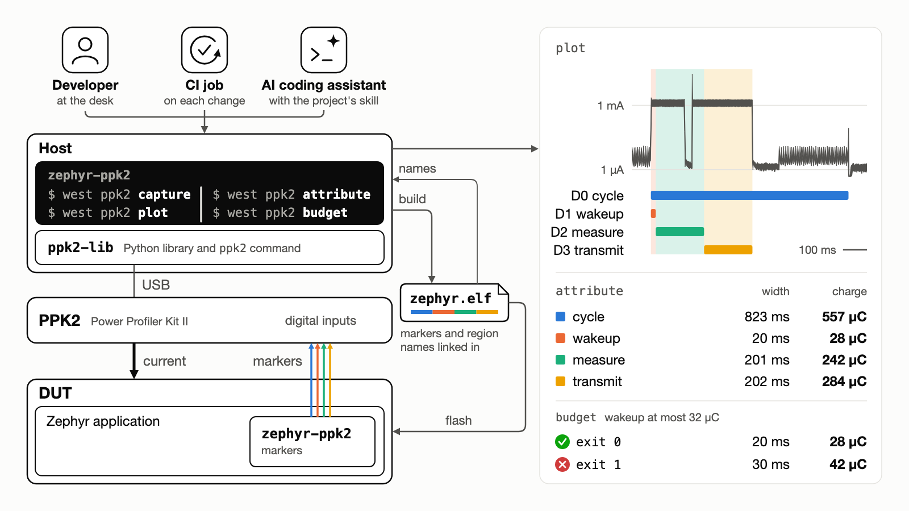

# zephyr-ppk2

A tiny [Zephyr module](https://docs.zephyrproject.org/latest/develop/modules.html)
that attributes consumed charge to firmware code. It integrates GPIO
markers into the firmware, and a Nordic
[Power Profiler Kit II](https://www.nordicsemi.com/Products/Development-hardware/Power-Profiler-Kit-2)
(PPK2) captures them together with the current. `west` commands then
associate the markers with named code regions and report the execution
time, mean current and consumed charge of each. Budgets on these can be
enforced through pass/fail checks in CI.

This is an experimental release. The interface may still change.


The figure is one cycle of [`samples/profiling`](samples/profiling) on
an nRF54LM20 DK. The `wakeup` phase lasts 20.16 ms and costs 28.27 µC.
Made 10 ms longer, it costs 42.45 µC, and the
[budget check](#step-4-budget-check) fails.

## Principle

Toggling GPIO pins around sections of code and inspecting them
alongside current traces is a traditional approach, usually done by
hand in an instrument's GUI. It is useful for debugging, but hard to
reproduce, and it rarely makes its way into continuous integration.
This module makes the marking a build option and the reading a command.

A PPK2 captures current and eight digital inputs simultaneously,
100,000 times per second. The firmware raises a pin around a section of
code, so the capture shows when that code ran. By correlating the
current with those markers, the host attributes the consumed charge to
individual functions or code blocks. Each region holds the current of
the whole device under test (DUT), not of the marked code alone.



## Requirements

- A PPK2, and a board with one free GPIO per channel.
- A [west](https://docs.zephyrproject.org/latest/develop/west/index.html)
  workspace. The module is developed on nRF Connect SDK v3.3.1.
- [ppk2-lib](https://github.com/rdagher/ppk2-lib) on the host, in the
  environment west runs from, with Python 3.11 or newer:

  ```sh
  pip install ppk2-lib
  ```

- [pyelftools](https://github.com/eliben/pyelftools) in the same
  environment, for `west ppk2 attribute` and `plot`. Zephyr's own
  requirements install it. `plot` also uses matplotlib and numpy. See
  [`scripts/requirements.txt`](scripts/requirements.txt) for the whole
  list, which `west packages pip` reads.

Only one program can hold a PPK2: quit Nordic's
[Power Profiler app](https://docs.nordicsemi.com/r/bundle/nrf-connect-for-desktop/page/app/pc-nrfconnect-ppk/using_ppk_app.html)
before capturing.

## Quick start

Four steps, from the module in your workspace to a budget check.

### Step 1: setup

Add the module to your `west.yml`. The `west-commands` line adds
`west ppk2`:

```yaml
  projects:
    - name: zephyr-ppk2
      url: https://github.com/rdagher/zephyr-ppk2
      revision: main
      west-commands: scripts/west-commands.yml
```

Run `west update`. Then, in the application:

1. In `prj.conf`: `CONFIG_GPIO=y` and `CONFIG_PPK2_TRACE=y`.
2. In the board overlay, the wired pins for the markers:

   ```dts
   / {
       zephyr,user {
           ppk2-d0-gpios = <&gpio1 12 GPIO_ACTIVE_HIGH>;
           ppk2-d1-gpios = <&gpio1 13 GPIO_ACTIVE_HIGH>;
       };
   };
   ```

3. Wire the PPK2's logic port: `D0` and `D1` accordingly, `GND` to the
   board's ground, `VCC` to the board's supply. [Bench](docs/bench.md)
   shows the wiring of the dev kits set up for the [`samples`](samples).

### Step 2: marking code

Include `<ppk2_trace.h>`. A channel 0 to 7 is the digital input D0 to
D7 of the PPK2.

```c
PPK2_TRACE_CLAIM(1, wakeup);          /* file scope: owns D1, names it "wakeup" */

void wakeup(void)
{
    PPK2_TRACE_SCOPE(ppk2_ch_wakeup); /* high until the function ends */
    ...
}
```

There are two more ways to mark code:

- a function at [link time](docs/marking.md#link-time-wrapping), without
  touching its source;
- the radio, by [hardware events](docs/marking.md#radio-channel).

See [Marking code](docs/marking.md) for the whole interface.

### Step 3: capture and report

```sh
west ppk2 run --source --vdd 3.3 -- west flash              # power the DUT while it is flashed
west ppk2 capture --source --vdd 3.3 --out trace.csv --seconds 60
west ppk2 attribute trace.csv                               # the report
west ppk2 plot trace.csv --window 3.1 4.5 --out cycle.png   # the figure
```


See [Commands](docs/commands.md) for each command and for the report.

### Step 4: budget check

`west ppk2 budget` exits 1 when the regions of a channel, or the idle
current, exceed a budget:

```sh
west ppk2 budget trace.csv --channel 1 --max-uc 32 --max-ms 22 --idle-max-ua 4
```

See [Commands](docs/commands.md#budget-check) for the budgets, the
output and a CI job.

## Samples

- [`profiling`](samples/profiling): a cycle of wakeup, measure and
  transmit, marked in the source.
- [`wrap_profiling`](samples/wrap_profiling): the same cycle, marked at
  link time.
- [`ble_advertising`](samples/ble_advertising): a BLE advertiser, with
  its radio marked by hardware events.

See [Samples](docs/samples.md) for what each one measures on the bench.

## Coding assistants

[`.claude/skills/ppk2-profile/SKILL.md`](.claude/skills/ppk2-profile/SKILL.md)
is a procedure an AI coding assistant can follow to find which code
draws the current: measure, mark more where the cost is, change one
thing, measure again, propose a budget.

An assistant that works in your application does not see this file,
because it is in the module's folder. Point to it from the
application's `AGENTS.md`:

```markdown
- To find which code draws the current, follow
  `.claude/skills/ppk2-profile/SKILL.md` in the zephyr-ppk2 module.
  `west list -f "{abspath}" zephyr-ppk2` prints the module's folder.
```

## Limitations

- Measured on one nRF54LM20 DK and, for the BLE sample, on one
  nRF54L15 DK, with one PPK2.
- The radio channel is only supported on the nRF54L series, and on the
  kits that the SDK's `CONFIG_MPSL_PIN_DEBUG` lists.
- A short region that contains a wake-up from sleep can read higher:
  trust the median.

See [Limitations](docs/limitations.md) for the full list.

## Documentation

- [Marking code](docs/marking.md): the interface, link-time wrapping,
  the radio channel.
- [Commands](docs/commands.md): the report, the figure, the budget
  check.
- [Without west](docs/without-west.md): the same steps with CMake,
  twister and the scripts called directly.
- [Limitations](docs/limitations.md): what was tested, and what was not.
- [Bench](docs/bench.md): the wiring of the dev kits.
- [Samples](docs/samples.md): what each sample measures on the bench.
- [Evidence](evidence/README.md): how the captures were taken, and
  where they are.

## Origin

The module and its documentation were written with Claude Code and
reviewed by the author. The figures were measured on a bench: see the
[evidence](evidence/README.md) and the
[limitations](docs/limitations.md).

## Licence

[Apache-2.0](LICENSE-APACHE) OR [MIT](LICENSE-MIT), at your option.

zephyr-ppk2 is not affiliated with or endorsed by Nordic Semiconductor
or the Zephyr Project. PPK2, Power Profiler Kit and nRF are Nordic's
product names.
