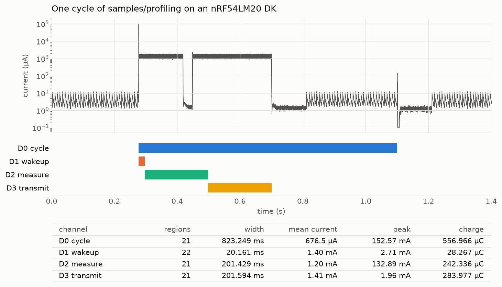

# zephyr-ppk2

A [Zephyr module](https://docs.zephyrproject.org/latest/develop/modules.html)
that measures the current and the charge drawn while marked code runs.
It marks code with GPIO pins that a Nordic
[Power Profiler Kit II](https://www.nordicsemi.com/Products/Development-hardware/Power-Profiler-Kit-2)
(PPK2) samples next to the current, and reports the width, the current
and the charge of each marked region. A budget check turns that report
into an exit code for CI. The capture itself is taken by
[ppk2-lib](https://github.com/rdagher/ppk2-lib).

This is an experimental release. The interface may still change.



The figure is one cycle of [`samples/profiling`](samples/profiling) on
an nRF54LM20 DK. Its `wakeup` phase lasts 20.16 ms and costs 28.27 µC.
Made 10 ms longer, it costs 42.45 µC, and the
[budget check](#budget-check) fails.

## Principle

Marking code with a pin and reading the pin next to the current is a
known practice, usually done by hand in the instrument's own
application. This module makes the marking a build option and the
reading a command, so that the measurement can be repeated, and run in
CI.

A PPK2 samples eight digital inputs with every current sample, 100,000
times per second. A pin held high while a piece of code runs therefore
marks, in the capture, the time that code ran. The host adds up the
current of the whole device under test (DUT) while each pin is high: an
interrupt or a radio event that falls inside a marked region is counted
in it.

A marker costs one GPIO write at each end. The radio marker costs no
CPU time: the hardware drives it. With `CONFIG_PPK2_TRACE=n` every
marker compiles to nothing, and the code builds unchanged.

The PPK2 measures current, so the figures are a current and a charge.
An energy needs a voltage, which the capture does not hold. With
`--vdd` the report adds one: the charge times that voltage, taken as
constant.

## Marking code

Include `<ppk2_trace.h>`. A channel 0 to 7 is the digital input D0 to
D7 of the PPK2.

```c
PPK2_TRACE_CLAIM(1, wakeup);          /* file scope: owns D1, names it "wakeup" */

void wakeup(void)
{
    PPK2_TRACE_SCOPE(ppk2_ch_wakeup); /* high until the function ends */
    ...
}
```

| Interface | Use |
|---|---|
| `PPK2_TRACE_CLAIM(ch, name)` | Claims a channel at file scope. Defines `ppk2_ch_<name>` and stores the name in the image, where the report reads it |
| `PPK2_TRACE_SCOPE(ch)` | Holds the channel high to the end of the enclosing block, on every way out |
| `ppk2_trace_set(ch, on)` | For a region that starts in one function and ends in another |
| `PPK2_TRACE_WRAP(ch, ret, fn, params, args)` | Marks a function at link time, without touching its source |
| `CONFIG_PPK2_TRACE_RADIO` | A channel the hardware holds high from the radio's READY event to DISABLED |

A claim fails to build when its channel is not wired in the
devicetree, and two C files that claim the same channel fail to link.
A name holds 14 characters at most.

### Link-time wrapping

To mark a function you cannot or do not want to edit, list it in one
file of your application and in CMake:

```c
/* trace.c */
PPK2_TRACE_WRAP_VOID(1, wakeup, (void), ());
PPK2_TRACE_WRAP(3, int, transmit, (int reading), (reading));
```

```cmake
ppk2_trace_wrap(wakeup transmit)
```

The linker then routes every call to `transmit` through a wrapper that
raises the channel. This reaches calls between files only: a `static`
or inlined function cannot be wrapped.

### Radio channel

```ini
CONFIG_PPK2_TRACE_RADIO=y
CONFIG_PPK2_TRACE_RADIO_CHANNEL=0
```

The radio's own events raise and drop the pin, through DPPI and GPIOTE:
READY raises it and DISABLED drops it. The ramp-up before READY is
outside the marked region, so its charge is that of this window and not
of the whole radio event. The channel is claimed under the name
`radio`; do not claim it again.


In [`samples/ble_advertising`](samples/ble_advertising) the radio is on
D0 and a sensor read on D1. Each advertising event shows three pulses
of 0.198 ms, one per advertising channel.

This is the one part of the module that is specific to a vendor. It is
for Nordic's nRF54L series under the
[nRF Connect SDK](https://github.com/nrfconnect/sdk-nrf), whose radio
layer ([MPSL](https://github.com/nrfconnect/sdk-nrfxlib/tree/main/mpsl))
publishes those events, and lives in `src/nordic/`. The rest of the
module is plain Zephyr: devicetree, the GPIO driver and a linker
option.

## Requirements

- A PPK2, and a board with one free GPIO per channel.
- A [west](https://docs.zephyrproject.org/latest/develop/west/index.html)
  workspace. The module is developed on nRF Connect SDK v3.3.1.
- [ppk2-lib](https://github.com/rdagher/ppk2-lib) on the host, in the
  environment west runs from, with Python 3.11 or newer:
  `pip install "git+https://github.com/rdagher/ppk2-lib"`.

Only one program can hold a PPK2: quit Nordic's
[Power Profiler app](https://docs.nordicsemi.com/r/bundle/nrf-connect-for-desktop/page/app/pc-nrfconnect-ppk/using_ppk_app.html)
before capturing.

## Setup

Add the module to your `west.yml`. The `west-commands` line is what
adds `west ppk2`:

```yaml
  projects:
    - name: zephyr-ppk2
      url: https://github.com/rdagher/zephyr-ppk2
      revision: main
      west-commands: scripts/west-commands.yml
```

Run `west update`. Then, in the application:

1. `CONFIG_GPIO=y` and `CONFIG_PPK2_TRACE=y` in `prj.conf`.
2. The pins in the board overlay, only the ones you wire:

   ```dts
   / {
       zephyr,user {
           ppk2-d0-gpios = <&gpio1 12 GPIO_ACTIVE_HIGH>;
           ppk2-d1-gpios = <&gpio1 13 GPIO_ACTIVE_HIGH>;
       };
   };
   ```

3. Wire the PPK2's logic port: `D0` to `D7` to those pins, `GND` to the
   board's ground, `VCC` to the board's supply. [Bench](docs/bench.md)
   has the wiring of the two dev kits the samples are set up for.

## Usage

```sh
west ppk2 run --source --vdd 3.3 -- west flash              # power the DUT while it is flashed
west ppk2 capture --source --vdd 3.3 --out trace.csv --seconds 60
west ppk2 attribute trace.csv                               # the report
west ppk2 plot trace.csv --window 3.1 4.5 --out cycle.png   # the figure
```


`list`, `capture`, `run` and `power` are passed on to the commands of
ppk2-lib. `attribute` and `plot` find `zephyr.elf` under `--build-dir`
(default `build`) and read the names of the claimed channels from it.
For `samples/profiling`, `attribute` prints:

```text
capture: 5999708 samples, 60.00 s powered
D0 cycle               n=21    width   823.249 ms  avg    676.55 µA  peak   152565 µA  charge   556.966 ± 1.810 µC (median 557.418)
D1 wakeup              n=22    width    20.161 ms  avg   1402.09 µA  peak     2708 µA  charge    28.267 ± 0.045 µC (median 28.264)
D2 measure             n=21    width   201.429 ms  avg   1203.09 µA  peak   132886 µA  charge   242.336 ± 1.617 µC (median 241.425)
D3 transmit            n=21    width   201.594 ms  avg   1408.66 µA  peak     1960 µA  charge   283.977 ± 0.152 µC (median 283.996)
idle (no channel high) median      3.02 µA  mean      4.53 µA
```

The first line counts the samples from power-on: before it the digital
inputs float. A region is a stretch where a channel is high, and only
the regions that begin and end inside the capture are counted. The
charge is given as the mean ± the standard deviation over the regions,
then the median. `--vdd 3.3` adds an energy column.

The capture must be at 100,000 samples per second with no row missing,
as `ppk2 capture` writes it and as the app exports it at full rate. An
export at a lower rate is refused. So is a capture in which the current
never rises above 200 µA, taken as a DUT that was not powered:
`--power-on-ua` sets that threshold for a DUT that draws less.

`plot` draws a figure like the one at the top of this page, which the
`plots` recipe of the [justfile](justfile) drew from the stored capture
of that sample. It needs [matplotlib](https://matplotlib.org/) and
[numpy](https://numpy.org/) in west's Python environment.

## Budget check

`west ppk2 budget` exits 1 when the regions of a channel, or the idle
current, exceed a budget. `--channel` picks the channel, D0 by default.
In a CI job on a runner wired to the bench:

```sh
west build -b nrf54lm20dk/nrf54lm20b/cpuapp zephyr-ppk2/samples/profiling
west ppk2 run --source --vdd 3.3 -- west flash
west ppk2 capture --source --vdd 3.3 --out trace.csv --seconds 60
west ppk2 budget trace.csv --channel 1 --max-uc 32 --max-ms 22 --idle-max-ua 4
```

```text
PASS mean region charge 28.27 µC (budget 32.00 µC)
PASS mean region width 20.16 ms (budget 22.00 ms)
PASS idle median 3.02 µA (budget 4.00 µA)
```

With `wakeup` made 10 ms longer, `busy_ms(30)` in place of
`busy_ms(20)`, the same command exits 1:

```text
FAIL mean region charge 42.45 µC (budget 32.00 µC)
FAIL mean region width 30.23 ms (budget 22.00 ms)
PASS idle median 3.02 µA (budget 4.00 µA)
```

The other phases and the idle current do not move, so the report points
at `wakeup` alone. [Samples](docs/samples.md#budget-on-one-phase) has
that report, and the same check on the BLE sample.

| Budget | Limits |
|---|---|
| `--max-ua` | The mean current of the regions, in µA |
| `--max-uc` | Their mean charge, in µC |
| `--max-ms` | Their mean width, in ms |
| `--max-peak-ua` | The highest sample of any region, in µA |
| `--max-uj`, with `--vdd` | Their mean energy, in µJ: the charge times that voltage, taken as constant |
| `--idle-max-ua` | The median current while no channel is high, in µA |

The budgets on a mean check the mean: one region can be above the
budget while the mean is below it.

Leave a few percent of margin in a budget. Two builds of the same
source differed by 0.7 % in a way that followed where the linker had
placed the code: [samples](docs/samples.md#wrap_profiling) has that
case. For the same reason, compare builds that carry the same markers,
and consider shipping the image you measured, markers included.

## Coding assistants

[`.claude/skills/ppk2-profile/SKILL.md`](.claude/skills/ppk2-profile/SKILL.md)
is a procedure an AI coding assistant can follow to find which code
draws the current: measure, mark more where the cost is, change one
thing, measure again, propose a budget. Every step is one of the
commands above.

## Samples

| Sample | Shows |
|---|---|
| [`samples/profiling`](samples/profiling) | A cycle of wakeup, measure and transmit, marked in the source |
| [`samples/wrap_profiling`](samples/wrap_profiling) | The same cycle, marked at link time from one file |
| [`samples/ble_advertising`](samples/ble_advertising) | A BLE advertiser: the radio by hardware, a sensor read in the source |

[Samples](docs/samples.md) has what each one measures on the bench, and
[`evidence/`](evidence/README.md) how the captures behind those figures
were taken and where they are.

## Limitations

- Measured on one nRF54LM20 DK with one PPK2. `profiling` and
  `wrap_profiling` build for the nRF52840 DK as well, but were not
  captured on it.
- The radio channel exists for the nRF54L series only. The rest uses
  only Zephyr's own interfaces, but has been built for two Nordic
  boards only, in an nRF Connect SDK workspace, and run on one.
- Eight channels, one region per channel at a time.
- A marker written by code costs that code a GPIO write at each end.
  Its duration was not measured.
- When a DUT wakes from sleep, the PPK2 changes range, and at about a
  third of the wake-ups four samples in a row (40 µs) read between
  about 30 and 180 mA. The app's captures carry the same bursts. One
  burst adds 2 to 5 µC, so a short region that contains a wake-up can
  read higher than the others, and so can the mean of a whole capture.
  The report gives the median of the charge next to its mean: when the
  two differ, trust the median.
  [`evidence/`](evidence/README.md#wake-up-bursts) has what is known
  about them.

## Licence

[Apache-2.0](LICENSE-APACHE) OR [MIT](LICENSE-MIT), at your option.

zephyr-ppk2 is not affiliated with or endorsed by Nordic Semiconductor
or the Zephyr Project. PPK2, Power Profiler Kit and nRF are Nordic's
product names.
