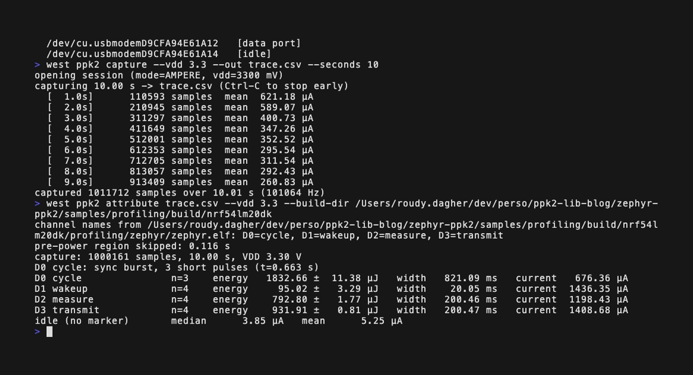

# zephyr-ppk2

Zephyr module for per-region power profiling with Nordic's Power
Profiler Kit II (PPK2): which code costs what — energy, width, and
mean current per function, phase, or block — and a CI gate that fails
the build when a change regresses power or timing. It is the firmware
half of a harness whose host half is
[ppk2-lib](https://github.com/rdagher/ppk2-lib).

## The approach

A bracket drives one of the PPK2's eight logic inputs high on entry
and low on exit — the context-manager / RAII idea, with a GPIO as the
scope. The PPK2 records all logic pins alongside every current sample
(100 kSPS); the host slices the current trace wherever a pin was high
and integrates. The result: energy (µJ), width (ms), mean and peak
current (µA) per bracketed region, plus the idle floor, at 10 µs
granularity — for the cost of one GPIO write per bracket edge. With
`CONFIG_PPK2_TRACE=n` every bracket compiles to nothing; instrumented
code builds unchanged.

## Inside Zephyr

Four mechanisms carry the approach into a Zephyr project:

- **Two ways to bracket** — *link-time*: a tracing module (`trace.c`)
  declares the monitored surface and `ppk2_trace_wrap(<fns>)` in
  CMake routes the calls (`-Wl,--wrap`) — the monitored code is
  untouched, yours or a vendor stack's. *In-source*: function-top
  annotation, block scopes, begin/end pairs, C++ RAII and a decorator
  — for what wrap can't reach and for fine-grained work. All forms
  and their constraints: [docs/instrumentation.md](docs/instrumentation.md).
- **Claimed channels** — `PPK2_TRACE_CLAIM(0, cycle)` makes one
  component own channel D0: a second claim of the same channel in
  another file is a duplicate-symbol link error (same file: compile
  error), and claiming a channel the overlay doesn't wire fails at
  compile time.
- **Names live in the image** — the claim also stores
  `{channel, "cycle"}` in a ROM section; `west ppk2 attribute` reads
  it from `zephyr.elf` and labels the report — no name flags to keep
  in sync with the firmware.
- **West workflow** — `west ppk2 list / capture / power / run /
  attribute`, added to the workspace by the manifest's
  `west-commands` line.

## The demo

The in-source form, abridged from `samples/profiling`:

```c
PPK2_TRACE_CLAIM(0, cycle);              /* own channel D0, name it "cycle" */

void run_cycle(void)
{
    PPK2_TRACE_FUNCTION(ppk2_ch_cycle);  /* D0 high on entry, low on any exit */

    wakeup();                            /* D1 — bracketed the same way */
    transmit(measure());                 /* D2, D3 */
    k_sleep(K_MSEC(400));
}
```

One capture later — the report labels come from the firmware's
claims, read out of `zephyr.elf`:



([the same session as a GIF](docs/demo.gif))

Three sibling samples run this cycle, one per instrumentation style:
`profiling` (annotations), `wrap_profiling` (tracing module —
file-for-file the same app, zero code touched), `profiling_cpp`
(RAII). Bench-measured on the nRF54LM20DK: cycle 1855 ± 9 µJ, deep
idle median 4.16 µA, cross-validated against a Nordic GUI golden
capture to +0.27 % over nine marker-aligned cycles — reference tables,
evidence, and run instructions in [docs/samples.md](docs/samples.md).

## Pick your path

- **Profile your application** — add the module
  ([Setup](#setup)), instrument
  ([docs/instrumentation.md](docs/instrumentation.md)), capture and
  attribute ([Everyday use](#everyday-use)).
- **Try the samples first** — wire a dev kit
  ([docs/bench.md](docs/bench.md)) and run the demo apps
  ([docs/samples.md](docs/samples.md)).

Either way you need a PPK2, a west workspace (developed and
bench-validated on NCS v3.3.1; upstream Zephyr works the same way),
and ppk2-lib's CLI on the host:
`pip install "git+https://github.com/rdagher/ppk2-lib"` (Python 3.11
or newer, in the environment west runs from, so that `ppk2` is on its
PATH). Quit Nordic's Power Profiler app while capturing: one process
owns the PPK2 at a time.

## Setup

In your `west.yml` — the `west-commands` line is what adds
`west ppk2` to your workspace:

```yaml
  projects:
    - name: zephyr-ppk2
      url: https://github.com/rdagher/zephyr-ppk2
      revision: main
      west-commands: scripts/west-commands.yml
```

Run `west update` to fetch it. (Ad hoc, without the manifest:
`-DZEPHYR_EXTRA_MODULES=/path/to/zephyr-ppk2` — build-only, no west
commands.) Then in your app:

1. `CONFIG_PPK2_TRACE=y` in `prj.conf` (needs `CONFIG_GPIO=y`) — the
   wired channels are configured at boot
   (`CONFIG_PPK2_TRACE_AUTO_INIT`).
2. Marker pins in your board overlay, only the ones you wire:

   ```dts
   / {
       zephyr,user {
           ppk2-d0-gpios = <&gpio0 28 GPIO_ACTIVE_HIGH>;
           ppk2-d1-gpios = <&gpio0 29 GPIO_ACTIVE_HIGH>;
       };
   };
   ```

3. `#include <ppk2_trace.h>` (or `.hpp`, which needs
   `CONFIG_STD_CPP17=y`), claim channels, mark regions.

On the bench, the PPK2's logic inputs go to those pins, its logic `GND`
to the board's ground and its logic `VCC` to the board's VDD
([docs/bench.md](docs/bench.md)).

## Everyday use

```sh
west ppk2 list                                   # PPK2s + per-port status
west ppk2 run --vdd 3.3 -- west flash            # power the DUT for a command
west ppk2 capture --vdd 3.3 --out trace.csv --seconds 30
west ppk2 attribute trace.csv --vdd 3.3          # labels from the image
```

`list`/`capture`/`run`/`power` pass through to ppk2-lib's CLI.
`attribute` finds `zephyr.elf` under `--build-dir` (default `build`),
reads the region names the claims embedded in the image, and prints
the labelled per-region report. Flash recipes and per-board bench
setups: [docs/bench.md](docs/bench.md).

## CI: fail the build on a power regression

`scripts/check_budget.py` turns attribution into a gate — exit 1 when a
region blows its energy, width, current (mean or peak), or idle-floor
budget — power *and* timing regressions both fail the build. On a
self-hosted runner wired to the bench, with the west workspace already
set up, the loop is the same commands you run at the desk:

```yaml
jobs:
  power-budget:
    runs-on: [self-hosted, ppk2-bench]
    steps:
      - uses: actions/checkout@v4
      - run: west build -b nrf54lm20dk/nrf54lm20b/cpuapp zephyr-ppk2/samples/profiling
      - run: west ppk2 run --vdd 3.3 -- west flash
      - run: west ppk2 capture --vdd 3.3 --out trace.csv --seconds 30
      - run: python zephyr-ppk2/scripts/check_budget.py trace.csv --vdd 3.3 --channel 0 --workload-max-uj 2300 --workload-max-ms 1025 --idle-max-ua 5.2
```

The budgets are the bench-measured reference + 25% headroom — this
exact gate passes on the reference capture and fails on a deliberately
tightened budget:


## Roadmap

Directions being explored, roughly in order:

- Per-thread energy attribution: a `CONFIG_TRACING` user backend that
  holds a channel high while a watched thread runs — no code changes in
  the app (prototype exists on a branch).
- Rust closure API for the markers.
- Instrument neutrality: split the marker/attribution contract from the
  PPK2 specifics so other power instruments plug in as backends, with
  room for custom extensions.
- A worked example on a real workload (TinyML inference energy).

## License

Apache-2.0 OR MIT, at your option.
