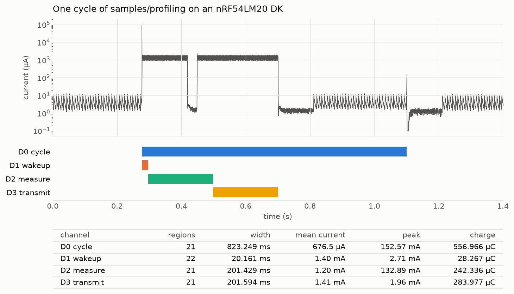

# Commands

The `west ppk2` commands capture the current, report it per marked
region, and check it against a budget.

| Command | What it does |
|---|---|
| `list`, `capture`, `run`, `power` | Passed on to the [commands of ppk2-lib](https://github.com/rdagher/ppk2-lib/blob/main/docs/user/command.md), which takes the capture itself |
| `attribute` | Prints the [report](#report) |
| `plot` | Draws the [figure](#figure) |
| `budget` | Exits 1 when a [budget](#budget-check) is exceeded |

They drive the
[PPK2](https://www.nordicsemi.com/Products/Development-hardware/Power-Profiler-Kit-2)
through [ppk2-lib](https://github.com/rdagher/ppk2-lib), whoever runs
them: a developer, a CI job or an AI coding assistant. See the
README's [quick start](../README.md#step-3-capture-and-report) for a session that runs
them in order.

## Region names

The names in the report come from the firmware:

1. The firmware is built with the markers and the names of their
   regions linked in.
2. It is flashed to the device under test (DUT).
3. The host reads the names back from `zephyr.elf` for the report.

`attribute` and `plot` read the names of the claimed channels from
`zephyr.elf`, which they find under `--build-dir`. The default is
`build`.

## Report

For [`samples/profiling`](../samples/profiling), `attribute` prints:

```text
capture: 5999708 samples, 60.00 s powered
D0 cycle               n=21    width   823.249 ms  avg    676.55 µA  peak   152565 µA  charge   556.966 ± 1.810 µC (median 557.418)
D1 wakeup              n=22    width    20.161 ms  avg   1402.09 µA  peak     2708 µA  charge    28.267 ± 0.045 µC (median 28.264)
D2 measure             n=21    width   201.429 ms  avg   1203.09 µA  peak   132886 µA  charge   242.336 ± 1.617 µC (median 241.425)
D3 transmit            n=21    width   201.594 ms  avg   1408.66 µA  peak     1960 µA  charge   283.977 ± 0.152 µC (median 283.996)
idle (no channel high) median      3.02 µA  mean      4.53 µA
```

How to read it:

- The first line counts the samples from power-on. Before it, the
  digital inputs float.
- A region is a stretch where a channel is high. Only the regions that
  begin and end inside the capture are counted.
- The charge is given as the mean ± the standard deviation over the
  regions, then the median.
- `--vdd 3.3` adds an [energy](#energy) column.

## Accepted captures

A capture must be at 100,000 samples per second, with no row missing.
`ppk2 capture` writes it that way, and so does Nordic's
[Power Profiler app](https://docs.nordicsemi.com/r/bundle/nrf-connect-for-desktop/page/app/pc-nrfconnect-ppk/using_ppk_app.html)
when it exports at full rate.

Two kinds of capture are refused:

- an export at a lower rate;
- a capture in which the current never rises above 200 µA, taken as a
  DUT that was not powered. For a DUT that draws less, `--power-on-ua`
  sets that threshold.

## Energy

The PPK2 measures current, so the figures are a current and a charge.
An energy needs a voltage, which the capture does not hold. With
`--vdd` the report adds one: the charge times that voltage, taken as
constant.

## Figure

`plot` draws a figure like the one below. It needs
[matplotlib](https://matplotlib.org/) and [numpy](https://numpy.org/)
in west's Python environment.



The `plots` recipe of the [justfile](../justfile) drew it from the
stored capture of `samples/profiling`. It shows one cycle, on an
[nRF54LM20 DK](https://docs.zephyrproject.org/latest/boards/nordic/nrf54lm20dk/doc/index.html):

- The three phases are busy waits at the same current, so the trace
  does not step from one phase to the next.
- The dip inside `measure` is a 30 ms sleep in its code, as a CPU would
  take while a sensor converts.
- The cycle ends with a 400 ms sleep while D0 is still high.

## Budget check

`west ppk2 budget` exits 1 when the regions of a channel, or the idle
current, exceed a budget. `--channel` picks the channel. The default
is D0.

### CI job

For example, on a runner wired to the bench:

```sh
west build -b nrf54lm20dk/nrf54lm20b/cpuapp zephyr-ppk2/samples/profiling
west ppk2 run --source --vdd 3.3 -- west flash
west ppk2 capture --source --vdd 3.3 --out trace.csv --seconds 60
west ppk2 budget trace.csv --channel 1 --max-uc 32 --max-ms 22 --idle-max-ua 4
```

```text
PASS mean region charge 28.27 µC (budget 32.00 µC)
PASS mean region width 20.16 ms (budget 22.00 ms)
PASS idle median 3.02 µA (budget 4.00 µA)
```

With `wakeup` made 10 ms longer, `busy_ms(30)` in place of
`busy_ms(20)`, the same command exits 1:

```text
FAIL mean region charge 42.45 µC (budget 32.00 µC)
FAIL mean region width 30.23 ms (budget 22.00 ms)
PASS idle median 3.02 µA (budget 4.00 µA)
```

The other phases and the idle current do not move, so the report points
at `wakeup` alone. See [Samples](samples.md#budget-on-one-phase) for
that report, and for the same check on the BLE sample.

### Budgets

| Budget | Limits |
|---|---|
| `--max-ua` | The mean current of the regions, in µA |
| `--max-uc` | Their mean charge, in µC |
| `--max-ms` | Their mean width, in ms |
| `--max-peak-ua` | The highest sample of any region, in µA |
| `--max-uj`, with `--vdd` | Their mean energy, in µJ: the charge times that voltage, taken as constant |
| `--idle-max-ua` | The median current while no channel is high, in µA |

Note that a budget on a mean checks the mean: one region can be above
the budget while the mean is below it.

### Margin

Leave a few percent of margin in a budget. Two builds of the same
source differed by 0.7 %, and the difference followed where the linker
had placed the code. See [Samples](samples.md#wrap_profiling) for
that case.

For the same reason:

- compare builds that carry the same markers;
- consider shipping the image you measured, markers included.

## See also

- [Marking code](marking.md): the markers, and the names the report
  reads.
- [Samples](samples.md): the report and the budget check of each
  sample.
- [Limitations](limitations.md)
- ppk2-lib's
  [command reference](https://github.com/rdagher/ppk2-lib/blob/main/docs/user/command.md):
  `list`, `capture`, `run` and `power` in detail.
