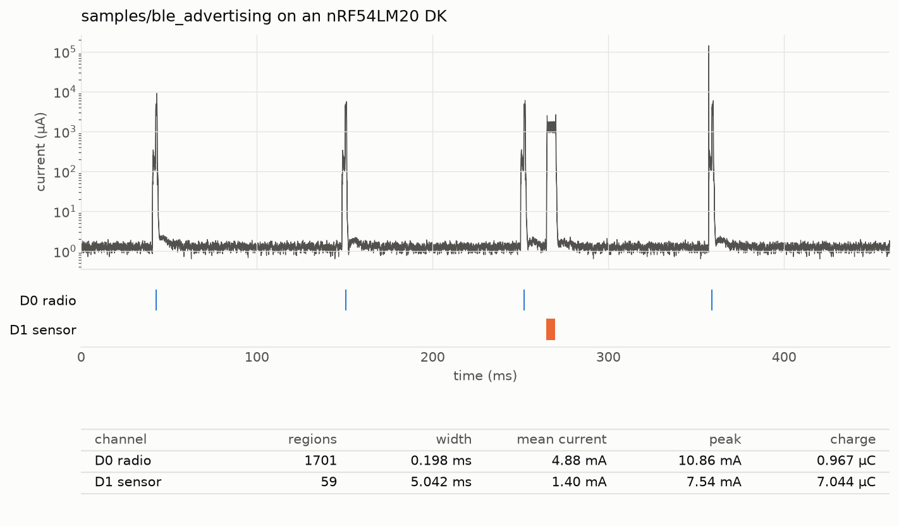

# Marking code

The ways to mark a region of code, and what a marker costs.

Include `<ppk2_trace.h>`. A channel 0 to 7 is the digital input D0 to
D7 of the
[PPK2](https://www.nordicsemi.com/Products/Development-hardware/Power-Profiler-Kit-2).

```c
PPK2_TRACE_CLAIM(1, wakeup);          /* file scope: owns D1, names it "wakeup" */

void wakeup(void)
{
    PPK2_TRACE_SCOPE(ppk2_ch_wakeup); /* high until the function ends */
    ...
}
```

[`samples/profiling`](../samples/profiling) marks a cycle of wakeup,
measure and transmit this way, in the source.

The host adds up the current of the whole device under test (DUT)
while each pin is high. An interrupt or a radio event that falls inside
a marked region is counted in it.

## Interface

| Interface | Use |
|---|---|
| `PPK2_TRACE_CLAIM(ch, name)` | Claims a channel at file scope. Defines `ppk2_ch_<name>` and stores the name in the image, where the report reads it |
| `PPK2_TRACE_SCOPE(ch)` | Holds the channel high to the end of the enclosing block, on every way out |
| `ppk2_trace_set(ch, on)` | For a region that starts in one function and ends in another |
| `PPK2_TRACE_WRAP(ch, ret, fn, params, args)` | Marks a function at link time, without touching its source |
| `CONFIG_PPK2_TRACE_RADIO` | A channel the hardware holds high from the radio's READY event to DISABLED |

Rules for a claim:

- It fails to build when its channel is not wired in the devicetree.
- Two C files that claim the same channel fail to link.
- A name holds 14 characters at most.

## Link-time wrapping

To mark a function you cannot or do not want to edit, list it in one
file of your application and in CMake:

```c
/* trace.c */
PPK2_TRACE_WRAP_VOID(1, wakeup, (void), ());
PPK2_TRACE_WRAP(3, int, transmit, (int reading), (reading));
```

```cmake
ppk2_trace_wrap(wakeup transmit)
```

The linker then routes every call to `transmit` through a wrapper that
raises the channel. Only calls between files go through the wrapper:
a `static` or inlined function cannot be wrapped.

[`samples/wrap_profiling`](../samples/wrap_profiling) marks the same
cycle as `samples/profiling` at link time, from one file.

## Radio channel

To mark the radio, enable these options:

```ini
CONFIG_PPK2_TRACE_RADIO=y
CONFIG_PPK2_TRACE_RADIO_CHANNEL=0
```

The radio's own events raise and drop the pin, through DPPI and GPIOTE:
READY raises it and DISABLED drops it. The ramp-up before READY is
outside the marked region, so the charge is that of this window, not of
the whole radio event.

The channel is claimed under the name `radio`: do not claim it again.



In [`samples/ble_advertising`](../samples/ble_advertising), a BLE
advertiser, the radio is on D0 and a sensor read on D1. Each
advertising event shows three pulses of 0.198 ms, one per advertising
channel.

### Portability

The radio channel is the one part of the module that is specific to a
vendor. It is only supported on Nordic's nRF54L series, under the
[nRF Connect SDK](https://github.com/nrfconnect/sdk-nrf), whose radio
layer ([MPSL](https://github.com/nrfconnect/sdk-nrfxlib/tree/main/mpsl))
publishes those events. Its code lives in `src/nordic/`.

The rest of the module is plain
[Zephyr](https://docs.zephyrproject.org/latest/): devicetree, the GPIO
driver and a linker option.

## Cost of a marker

- A marker written by code costs one GPIO write at each end. Its
  duration was not measured.
- The radio marker costs no CPU time: the hardware drives it.
- With `CONFIG_PPK2_TRACE=n` every marker compiles to nothing, and the
  code builds unchanged.

## See also

- [Commands](commands.md): the report, which reads the names of the
  claims.
- [Samples](samples.md): the three samples, measured on the bench.
- [Limitations](limitations.md)
