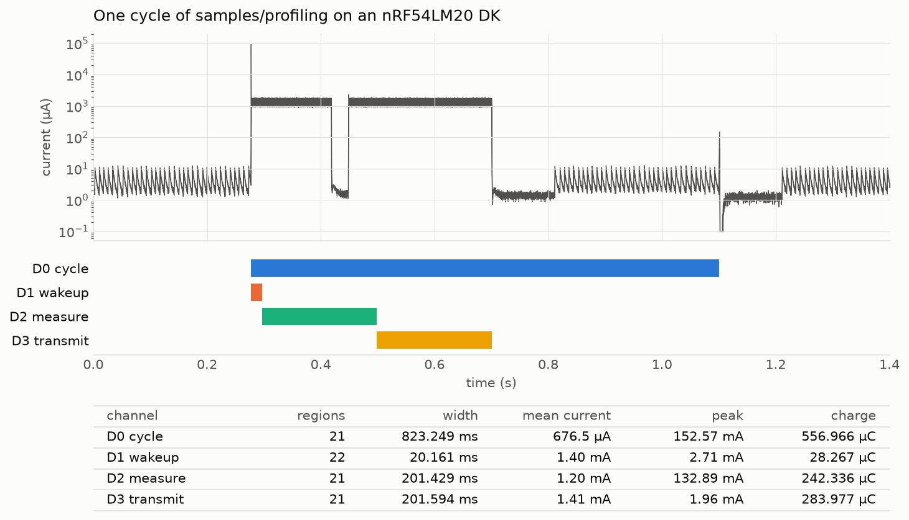
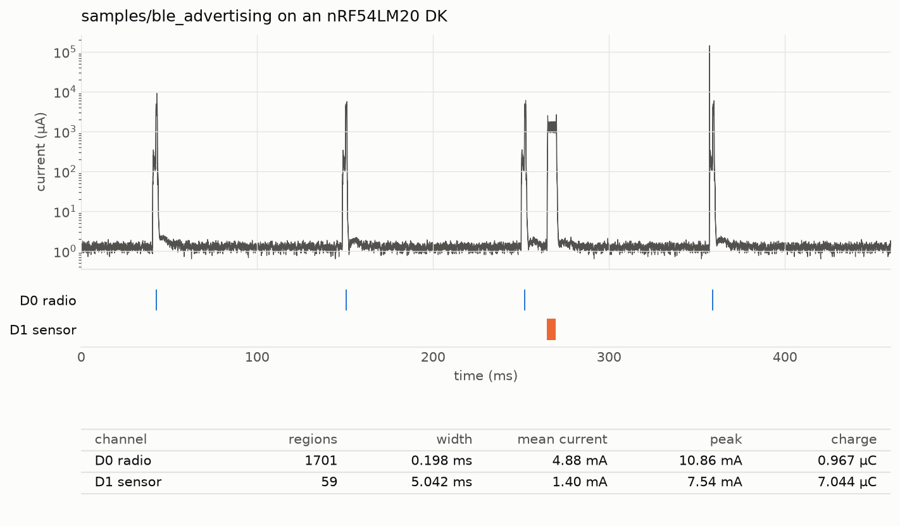

# Samples

Three applications, each with its markers. The figures below were
measured on 2026-11-21 on an nRF54LM20 DK, with the PPK2 in Source
meter mode at 3.3 V. The captures are in [`evidence/`](../evidence/README.md).

## Running a sample

Wire the dev kit first: see [bench](bench.md).

```sh
west build -b nrf54lm20dk/nrf54lm20b/cpuapp zephyr-ppk2/samples/profiling
west ppk2 run --source --vdd 3.3 -- west flash
west ppk2 capture --source --vdd 3.3 --out trace.csv --seconds 12
west ppk2 attribute trace.csv
```

## `profiling`

A cycle every 2.8 s: `wakeup` (20 ms busy), `measure` (120 ms busy, a
30 ms wait, 50 ms busy), `transmit` (200 ms busy), then a 400 ms sleep
inside the cycle. Each function starts with `PPK2_TRACE_SCOPE`.

| Channel | Regions | Width | Mean current | Charge |
|---|---|---|---|---|
| D0 cycle | 4 | 823.175 ms | 676.53 µA | 556.9 ± 2.4 µC |
| D1 wakeup | 5 | 20.158 ms | 1402.74 µA | 28.276 ± 0.094 µC |
| D2 measure | 4 | 201.375 ms | 1202.51 µA | 242.2 ± 2.0 µC |
| D3 transmit | 4 | 201.577 ms | 1407.88 µA | 283.80 ± 0.17 µC |
| Idle | | | 3.02 µA median | |



The 30 ms wait inside `measure` shows as a dip, and the 400 ms sleep as
the flat stretch while D0 stays high.

## `wrap_profiling`

The same application with no marker in its source. `trace.c` lists the
four functions with `PPK2_TRACE_WRAP`, and `CMakeLists.txt` passes them
to `ppk2_trace_wrap()`. The names in the report are those of the
functions.

| Channel | Regions | Width | Mean current | Charge |
|---|---|---|---|---|
| D0 run_cycle | 4 | 823.293 ms | 671.05 µA | 552.5 ± 2.1 µC |
| D1 wakeup | 5 | 20.158 ms | 1392.80 µA | 28.076 ± 0.073 µC |
| D2 measure | 4 | 201.435 ms | 1188.83 µA | 239.47 ± 0.12 µC |
| D3 transmit | 4 | 201.630 ms | 1397.08 µA | 281.69 ± 0.10 µC |
| Idle | | | 3.02 µA median | |

The two ways of marking agree within 1.2 % on every channel. The
largest difference is on `measure`: in the first capture one of its
regions contains a wake-up burst (a peak of 132 mA), which moves its
mean. The medians of the charge agree within 0.7 %.

## `ble_advertising`

A BLE advertiser that reads a sensor once a second and puts the value
in its advertising data. D0 is the radio channel, driven by hardware.
D1 is the sensor read, a 5 ms busy wait marked in the source.

| Channel | Regions | Width | Mean current | Charge |
|---|---|---|---|---|
| D0 radio | 270 | 0.198 ms | 4799.91 µA | 0.951 ± 0.031 µC |
| D1 sensor | 9 | 5.040 ms | 1371.88 µA | 6.914 ± 0.021 µC |
| Idle | | | 1.35 µA median | |



There are three radio pulses per advertising event, one per advertising
channel, and an event about every 100 ms.

### A regression caught

With the budgets below, the sample passes:

```sh
west ppk2 budget trace.csv --channel 1 --max-uc 8 --max-ms 6 --idle-max-ua 2
```

```text
PASS region charge 6.91 µC (budget 8.00 µC)
PASS region width 5.04 ms (budget 6.00 ms)
PASS idle median 1.35 µA (budget 2.00 µA)
```

Make the sensor read three times longer, `k_busy_wait(15000)` in
`read_sensor`, then build, flash and capture again. The same command
exits 1:

```text
FAIL region charge 21.41 µC (budget 8.00 µC)
FAIL region width 15.13 ms (budget 6.00 ms)
PASS idle median 1.35 µA (budget 2.00 µA)
```

The radio and the idle current are unchanged, so the report points at
the sensor read alone.
