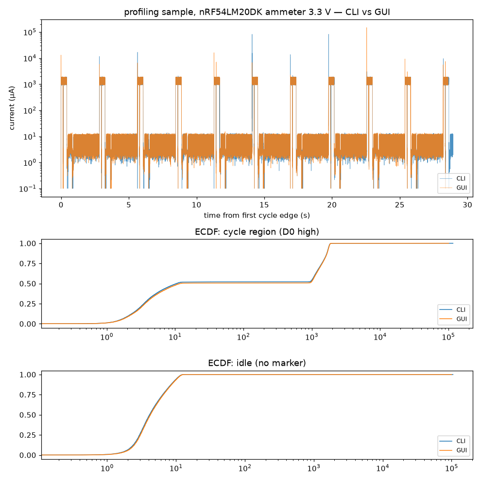

# Evidence round: `samples/profiling` — CLI vs Nordic GUI

nRF54LM20DK, ammeter mode 3.3 V, back-to-back 30 s captures of the
same bench (2026-08-22): one by ppk2-lib's CLI, one exported from the
Nordic Power Profiler GUI. Raw captures in [`captures/`](captures/),
harness reports in [`reports/`](reports/), regenerable plot in
[`plots/`](plots/).



## Per-phase attribution, both captures

`scripts/attribute.py`, `--vdd 3.3`, names from the sample:

| Region | CLI | GUI | Δ energy, CLI vs GUI |
|---|---|---|---|
| cycle (D0) | 1854.77 ± 8.81 µJ, 820.66 ms, 684.88 µA | 1856.47 ± 11.28 µJ, 820.18 ms, 685.91 µA | −0.09 % |
| wakeup (D1) | 99.71 ± 6.95 µJ, 20.02 ms, 1509.05 µA | 96.15 ± 2.07 µJ, 20.00 ms, 1456.51 µA | +3.7 %¹ |
| measure (D2) | 804.89 ± 5.20 µJ, 200.30 ms, 1217.70 µA | 805.45 ± 5.93 µJ, 200.10 ms, 1219.77 µA | −0.07 % |
| transmit (D3) | 940.53 ± 0.43 µJ, 200.27 ms, 1423.15 µA | 941.62 ± 0.39 µJ, 200.01 ms, 1426.65 µA | −0.12 % |
| deep idle | median 4.16 µA | median 4.25 µA | — |

¹ The 20 ms wakeup region has ±7 % cycle-to-cycle spread in these
non-simultaneous runs; the Δ of means sits well inside the overlap —
run-to-run workload variance, not instrument disagreement.

## Statistical comparison (ppk2-lib validation harness)

Two rounds with `validation.compare_cli` (Δ is CLI relative to GUI,
as in the table above):

| | Mean Δ | KS | Contract |
|---|---|---|---|
| Whole captures ([report](reports/ref_vs_gui.md)) | +3.87 % | 0.0132 | **fail** (mean) |
| 9 aligned cycles ([report](reports/ref_vs_gui_aligned.md)) | **+0.27 %** | 0.0175 | **pass** |

The whole-capture failure is a windowing artifact, not instrument
disagreement: non-simultaneous captures slice the 2.8 s cycle
differently, and the GUI export includes ~0.5 s of unpowered pre-boot
samples (floating logic pins). Trimming both captures to the same
marker-aligned 9 cycles ([`trim_cycles.py`](trim_cycles.py)) makes
them comparable — mean Δ +0.27 %, per-pin duty cycles agreeing to the
third decimal. Marker-aligned, region-based comparison is the moral of
this round.

## Regenerate

```sh
# plot (from the zephyr-ppk2 root)
uv run --with matplotlib python validation/evidence/profiling_lm20/make_plots.py

# reports (from this directory; LIB is a ppk2-lib checkout, for its harness)
compare() { PYTHONPATH=$LIB uv run --project $LIB --group validation \
    python -m validation.compare_cli "$@"; }
compare captures/profiling_lm20_cli.csv.gz captures/profiling_lm20_gui.csv.gz \
    --label-a "zephyr-ppk2 CLI ref" --label-b "GUI golden" --out reports/ref_vs_gui.md
python trim_cycles.py captures/profiling_lm20_cli.csv.gz cli_9c.csv
python trim_cycles.py captures/profiling_lm20_gui.csv.gz gui_9c.csv
compare cli_9c.csv gui_9c.csv \
    --label-a "CLI 9 cycles" --label-b "GUI 9 cycles" --out reports/ref_vs_gui_aligned.md
```
